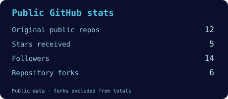
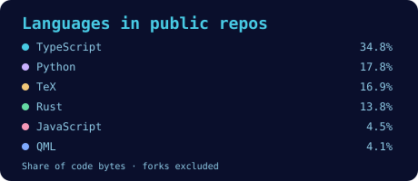
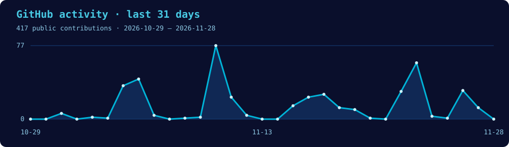

  

  

  embedded systems &nbsp;·&nbsp; telemetry &nbsp;·&nbsp; fullstack &nbsp;·&nbsp; product

  <a href="https://heitorm50.github.io/"><strong>Explore my portfolio → projects, case studies &amp; Embedded Lab</strong></a>

  

 

  

  

 

 

 

 

 

 

  
  
  
  
  
  

  

<h2 align="center">About</h2>

Software Engineering student at the <strong>University of Brasília (UnB)</strong>, based in <strong>Brasília, DF, Brazil</strong>. 
I work at the border between <strong>software and hardware</strong> — from sensors and CAN bus to dashboards and APIs — 
and I like seeing the product value of what I engineer. 
Looking for an <strong>internship, junior developer, trainee or freelance</strong> role (remote or hybrid in DF).

 

<h2 align="center">What I'm Building</h2>

[ TELEMETRY ] &nbsp;Baja SAE electronic platform — 4-node ECU network over CAN bus, ESP32 + live TFT dashboard for the pilot 
[ RESEARCH ] &nbsp;Multibody vehicle-dynamics model in C++, validated against Project Chrono (PIBIC) 
[ DATA ] &nbsp;RPM · Temperature · Speed · Fuel Level · GPS

 

<h2 align="center">Current Focus</h2>

[ EMBEDDED ] &nbsp;Software architecture & real-time systems 
[ ALGORITHMS ] &nbsp;Data structures in Rust — trees, graphs, spatial search 
[ COMMUNICATION ] &nbsp;CAN Bus · Bluetooth 
[ AI-ASSISTED DEV ] &nbsp;Claude Code in my daily workflow · LLM APIs · RAG with embeddings 
[ PRODUCT ] &nbsp;Backlog, requirements & user stories — building what matters

  

<h2 align="center">Experience</h2>

| Period | Role | Highlights |
|---|---|---|
| Mar 2024 – present | **Electronics Lead (Embedded Systems)** · UnBaja / Baja SAE UnB | Lead the electronics subsystem (4 members): task planning, technical roadmap and reporting to the university. Conceived and developed the embedded telemetry system for **Baja SAE Nacional 2026** — 4-node ECU architecture over CAN bus, with an ESP32 handling sensor data and showing it live on a TFT display. Own the whole chain: sensor reading, CAN protocol, data handling and on-board UI. |
| Jun 2026 – present | **Undergraduate Researcher (PIBIC)** · University of Brasília | Vehicle dynamics: building in **C++** a multibody model validated against the **Project Chrono** physics engine, with a **Godot** visualization sandbox and Docusaurus docs. A paper is planned as a deliverable (none published yet). |
| Jun 2025 – Jun 2026 | **Product Owner Jr. (intern)** · Ministry of Science, Technology and Innovation (MCTI) | Built, on my own initiative, **ExtracaoRDA** — a Python desktop app (PyQt, PyInstaller, pytest) that reads PADIS PDF reports with regex and generates validated Excel sheets, replacing manual transcription. Added an automatic validation layer that cross-checks values against other sources to flag inconsistencies. Followed Scrum ceremonies with the PO, validating business rules and mapping system errors. |

 

<h2 align="center">Featured Projects</h2>

| Project | What it is | Stack |
|---|---|---|
| **[Hindsight](https://github.com/HeitorM50/OsBiruBob)** *(hackathon, team)* | Analyzes IBM Bob sessions, finds context waste and generates a corrected config for A/B comparison. Team-measured result: −25.9% fixed overhead and −19.7% API cost. *My part:* A/B experiment, comparison UI, React skeleton, three detectors and static deploy with CI. | TypeScript · React · Vite · Vitest · GitHub Actions |
| **[CoOps](https://github.com/unb-mds/2025-2-Squad-01)** *(team)* | Web platform of GitHub collaboration metrics with interactive D3.js dashboards and OpenAI-powered explanations; layered (bronze/silver/gold) data pipeline, six GitHub Actions CI/CD pipelines. *My part:* unit, integration and automated tests, a React front-end feature, and support on the medallion-architecture optimization. | Python · React · TypeScript · pytest · D3.js |
| **[Crianex Hub](https://github.com/mdsreq-fga-unb/REQ-2026.1-T02-Crianex-)** | Bilingual admin platform and digital storefront for a **real client** (Software House Crianex), **live in production** at [crianex.onrender.com](https://crianex.onrender.com). Requirements gathered with the client under FDD + Kanban. | SvelteKit · PostgreSQL (Supabase) · Render |
| **rbtree-db** | Key-value database persisted on a Red-Black tree, range queries in O(log n + k), Redis-like REPL, Criterion benchmarks vs. `BTreeMap` and `HashMap`. | Rust |
| **CryptoArbitrageGraph** | Triangular arbitrage detection: currencies as a weighted graph + Bellman-Ford, CoinGecko API, CLI and interactive graph. | Python |
| **Quadtree Image Compressor** | Grayscale image compressor with Quadtree spatial search and custom binary serialization — ~98% compression keeping PSNR > 30 dB. | Python · NumPy · Pillow |
| **[dev-second-brain](https://github.com/HeitorM50/dev-second-brain)** | Local MCP server with embedding search (RAG) to store project context and decisions. | TypeScript |
| **[OmaPkDex](https://github.com/HeitorM50/omapkdex)** · **[omarchy-gcal](https://github.com/HeitorM50/omarchy-gcal)** | Omarchy bar widgets: a virtual companion that evolves with your AI token usage, and a Google Calendar integration (OAuth + systemd). MIT. | QML · Quickshell |
| **[IA2 · BloodMNIST](https://github.com/HeitorM50/IA2-2026.2)** | Blood-cell classification model comparison with PyTorch and scikit-learn, written up as an IEEE-format paper (AI II, UnB/FCTE). | Python · PyTorch · LaTeX |
| **AlugaFacil** · **Rusty Explorer** | Fleet manager for a car-rental company (Next.js + TypeScript + Node.js) · file explorer in Rust comparing sorting and search algorithms. | TypeScript · Rust |

 

<h2 align="center">Hackathons</h2>

- 🥇 **IBM TechXchange 2026 (Aug 2026) — 1st place** with *Hindsight* (team).
- 🥇 **PMI-DF Hackathon · PMI Sleep 5 (Sep 2026) — 1st place in IBM's independent technical evaluation** *(not the overall hackathon)*. A credit-analysis workspace that gathers client, operation and evidence to support human review (simulated data). My contribution was on the **product side**, not implementation: product concept and business rules, Product Model Canvas and pitch script, guiding the team's implementation. [Repo](https://github.com/guxvr/PMI-Sleep-5)

 

<h2 align="center">Education & Certifications</h2>

**Education**
- B.Sc. in **Software Engineering** — University of Brasília (UnB), Mar 2024 – Mar 2029 *(in progress)*
- **Analysis and Systems Development** — GRAN, Mar 2024 – Aug 2027 *(in progress)*

**Certifications**
- IBM Certified Bob v2 Developer — Associate (Oct 2026, exam C3000-006, proctored at Pearson VUE)
- IBM Artificial Intelligence v1 — Associate (Oct 2026, exam C1000-206, proctored at Pearson VUE)
- Claude 101 and Introduction to Claude Cowork — Anthropic
- UnB extension certificates: Competition Team, Course Showcase, Research Labs

**Languages:** Portuguese (native) · English (advanced, full professional working proficiency)

  

  
  

  

 

  

 

  <picture>
    <source media="(prefers-color-scheme: dark)" srcset="https://raw.githubusercontent.com/HeitorM50/HeitorM50/output/github-contribution-grid-snake-dark.svg">
    <source media="(prefers-color-scheme: light)" srcset="https://raw.githubusercontent.com/HeitorM50/HeitorM50/output/github-contribution-grid-snake.svg">
    
  </picture>

  

  

